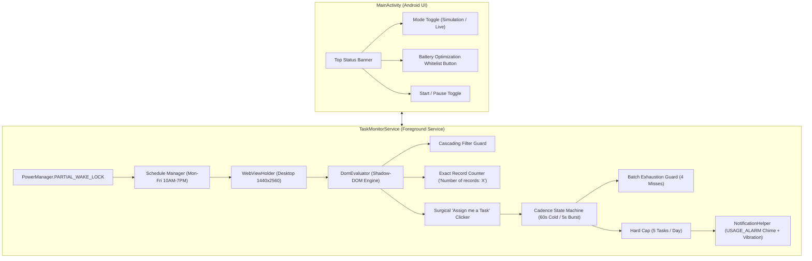

# RenderThat Task Assigner (Android)

Automated task assignment client for the RenderThat Lidl Food pipeline (`login.creator.renderthat.com/s/lidl-food-pipeline-tasks`). Runs natively on Android in the background via a foreground service with wake locks—no need to keep your PC powered on.

---

## 🚀 Download APK

Grab the ready-to-install Android APK directly:
* [Download RenderThatTaskAssigner-v1.0.0.apk](./release/RenderThatTaskAssigner-v1.0.0.apk) (5.94 MB)
* Or [app-debug.apk](./app-debug.apk)

---

## ✨ Features

- **📱 Standalone Phone Automation:** Runs in an Android 14+ compliant `specialUse` Foreground Service with `PowerManager.PARTIAL_WAKE_LOCK`. You can lock your phone screen or use other apps without the background polling being interrupted.
- **🖥️ Service-Owned Desktop WebView (`WebViewHolder`):** Sized to a fixed desktop resolution (`1440 x 2560`) with a desktop Chrome user-agent so that wide filter bars and table columns stay fully rendered off-screen. Session cookies are automatically persisted via `CookieManager`.
- **🛡️ Salesforce Shadow-DOM Evaluator (`DomEvaluator`):** Recursively traverses nested `.shadowRoot` boundaries across Lightning Web Components (LWC).
- **🔒 Cascading Filter Enforcement:** Automatically verifies and locks:
  - **Show:** `My`
  - **Account:** `Lidl Stiftung & Co. KG` (substring match `lidl`)
  - **Quote:** `Food`
  - **Team:** `Shading`
- **⚡ Dual-Speed State Machine:**
  - **Cold Search:** Clicks every **60 seconds** (+ random jitter) during active working hours (Monday–Friday, 10:00 AM – 7:00 PM).
  - **Burst Mode:** Accelerates to **every 5 seconds** (+ jitter) when tasks are detected in the pipeline table.
  - **Batch Exhaustion Guard:** If 4 consecutive burst clicks yield 0 new tasks:
    - If $\ge 3$ tasks secured: Stops clicking for the session (target met!) and rings the alarm chime.
    - If $< 3$ tasks secured: Drops back to 60s cold search to prevent server spam.
  - **Hard Stop at 5 Tasks:** Halts button clicks completely for the rest of the day.
  - **Button Disappearance Safety:** Safely skips clicks without errors when the button is missing or hidden.
- **🔔 Loud Audio Chime (`USAGE_ALARM`):** Plays audio chime on the alarm audio stream with hardware vibration, piercing through silent or vibrate modes.
- **🧪 Built-in Interactive Simulator:** Allows complete offline testing of cold search, burst clicks, batch exhaustion, and alerts before running against the live portal.

---

## 🛠️ Architecture



---

## 📲 Installation & Setup

1. **Install APK:**
   - Download [`RenderThatTaskAssigner-v1.0.0.apk`](./release/RenderThatTaskAssigner-v1.0.0.apk) to your Android device.
   - Tap the file to install (allow *"Install unknown apps"* if prompted).
2. **Grant Permissions:**
   - Open the app and grant **Notification Permission**.
   - Tap the **Battery Icon** (⚡) in the top-right corner to set Battery Optimization to **Unrestricted** (prevents Android Doze mode from sleeping the worker).
3. **Test in Simulation Mode:**
   - The app starts in **🧪 SIMULATION** mode.
   - Tap **START AUTO-ASSIGN**.
   - Tap **[ 📦 Drop Batch (3 Tasks) ]** inside the page to watch the app switch to 5s burst mode, claim all 3 tasks, detect batch exhaustion on the 4th click, stop, and play the alarm chime!
4. **Switch to Live Portal:**
   - Tap the top **[ 🧪 SIMULATION ]** button to switch to **[ 🌐 LIVE PORTAL ]**.
   - Log in once with your RenderThat credentials.
   - Confirm filters (`Show: My`, `Account: Lidl`, `Team: Shading`).
   - Tap **START AUTO-ASSIGN**.

---

## 🔨 Building from Source

Prerequisites:
- JDK 17 (Eclipse Adoptium OpenJDK 17 recommended)
- Android SDK 34 (Android 14)

```bash
git clone https://github.com/armanpier/renderthat-task-assigner.git
cd renderthat-task-assigner

# Run Unit Tests
./gradlew testDebugUnitTest

# Build Debug APK
./gradlew assembleDebug

# Output APK: app/build/outputs/apk/debug/app-debug.apk
```

---

## 📄 License
MIT License.
